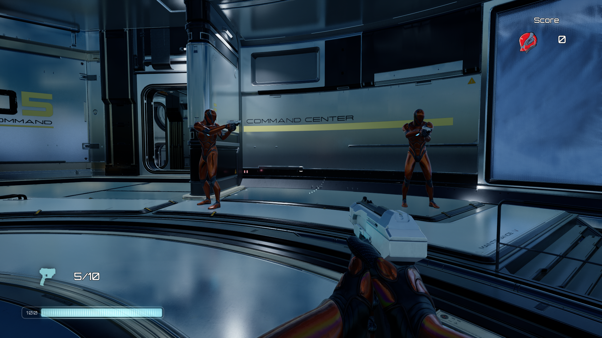

# FPSDemo — Unreal Engine 5

### An open-source multiplayer FPS built with Unreal Engine 5, featuring C++ gameplay systems and networked combat.

[**Play the Demo on itch.io**](https://omaralesharie.itch.io/fpsdemo) · [**View Source Code**](https://github.com/OmarAlesharie/FPSDemo) · [**Original Project**](https://github.com/DruidMech/UE5_Multiplayer_FPS)

---

## About the Project

FPSDemo is a multiplayer first-person shooter developed with **Unreal Engine 5, C++, and Blueprints**.

The project is based on the original [UE5 Multiplayer FPS project by DruidMech](https://github.com/DruidMech/UE5_Multiplayer_FPS), with my own modifications and planned expansions.

This project serves as a practical demonstration of my Unreal Engine development skills, focusing on gameplay programming, multiplayer networking, and game systems development.

The source code is publicly available, and the playable demo is free to download.

## Features

- **Multiplayer FPS:** First-person shooter gameplay with networked player interactions.
- **C++ & Blueprints:** A combination of native Unreal Engine C++ and Blueprint gameplay development.
- **Multiplayer Systems:** Implementation and testing of multiplayer functionality.
- **Open Source:** Publicly available source code for developers to explore.
- **Free Demo:** Download and play the current build at no cost.

## Roadmap

This project is a work in progress. Planned improvements include:

- [ ] Additional multiplayer game modes.
- [ ] New maps and environments.
- [ ] Additional weapons and combat mechanics.
- [ ] Further multiplayer networking improvements.
- [ ] General gameplay and performance improvements.

This roadmap may evolve as development progresses.

## Download and Play

You can download the latest available demo from itch.io:

**[➡️ Play FPSDemo on itch.io](https://omaralesharie.itch.io/fpsdemo)**

Check the game page for the available build, platform requirements, and instructions for playing.

## Project Background

This project builds upon the work of the original developer:

**Original Repository:** [DruidMech/UE5_Multiplayer_FPS](https://github.com/DruidMech/UE5_Multiplayer_FPS)

The original project provided the foundation for this work. This repository contains my version, including my modifications and future additions.

Please refer to the original repository's license and the licenses of any included third-party assets when determining applicable usage and redistribution rights.

## Technologies

- **Unreal Engine 5**
- **C++**
- **Unreal Engine Blueprints**
- **Multiplayer Game Development**

## About Me

I'm an independent game developer with experience in gameplay programming, Unreal Engine, C++, and technical game development.

This project is part of my development portfolio and demonstrates my practical work with Unreal Engine and multiplayer game systems.

GitHub: [OmarAlesharie](https://github.com/OmarAlesharie)

---

**If you find this project interesting, feel free to explore the source code and try the demo!**
